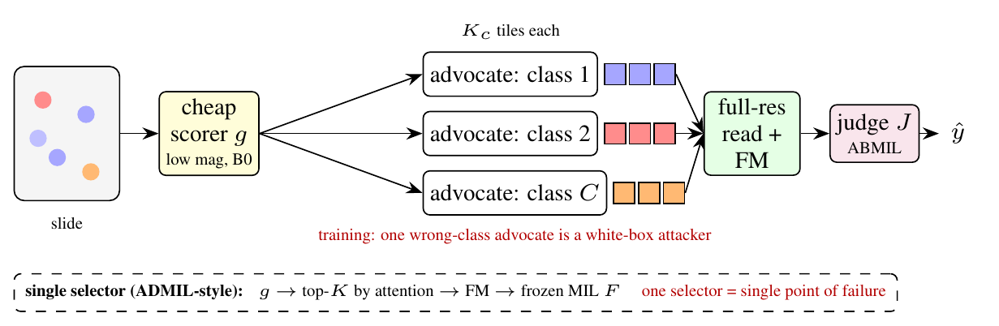
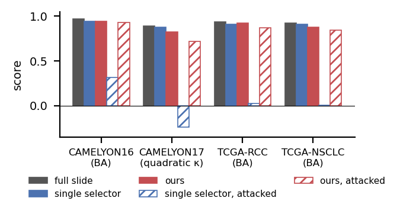
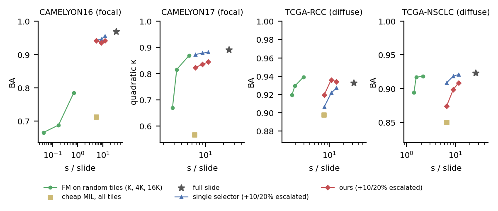

# One Advocate per Diagnosis

**Robust cheap evidence selection for whole-slide image classification**

Efficient whole-slide image (WSI) pipelines let a cheap low-magnification network pick a few tiles for an expensive pathology foundation model. That makes the selector a single point of failure. We give each candidate diagnosis its own cheap *advocate* and train a foundation-model *judge* against one adversarial advocate. This keeps the 4–6× speed-up of selective inference and removes the failure mode. We also show when cheap selection is worth it at all: for focal disease, yes; for diffuse subtyping, random tiles are enough.



## Results

Clean and compromised-selector scores: mean over 3 runs on CAMELYON16 and 5 folds × 3 seeds elsewhere. "Attacked" means one selector is replaced by a white-box attacker.

| | CAMELYON16 BA | CAMELYON17 κ | TCGA-RCC BA | TCGA-NSCLC BA |
|---|---|---|---|---|
| full-slide MIL (all tiles) | .969 | .890 | .933 | .923 |
| single selector (ADMIL-style) | .943 | .873 | .907 | .909 |
| **advocates (ours)** | .942 | .823 | .920 | .874 |
| single selector, attacked | .315 | −.241 | .022 | .003 |
| **advocates, attacked** | **.931** | **.715** | **.866** | **.841** |
| tiles encoded / slide | 16 | 16 | 12 | 8 |
| s / slide: full → selective | 33.3 → 5.5 | 24.4 → 6.7 | 32.4 → 7.9 | 26.3 → 6.6 |

Under attack, advocates beat the single selector on all four datasets (paired slide-level bootstrap, p < .001; [`results/stats.md`](results/stats.md)). On clean slides they are level on CAMELYON16 and RCC and significantly behind on CAMELYON17 and NSCLC.



**When does selection matter?** Here every method is plotted as accuracy against measured per-slide cost. On focal tasks (lymph-node metastasis), random tiles fail and a selector is required. On diffuse subtyping (RCC, NSCLC), a few random tiles match any selector at a quarter of the cost. The full table is in [`results/compute_table.md`](results/compute_table.md).



## Repository layout

```
paper/        two-column preprint (main.tex) and the anonymous MICCAI/LNCS version generated from it (to_lncs.py -> main_lncs.tex)
analysis/     tables and figures from results/
  compute_table.py   accuracy vs. per-slide cost for every method and dataset
  stats.py           paired slide-level bootstrap (95% CI, p) for the main comparisons -> results/stats.md
  fig_paper.py       paper figures
  tcga_agg.py, c17_cases.py, rcc_cases.py   per-class and per-case analyses
  cyto_pilot.py      cervical-cytology go/no-go (private data; not in the paper)
src/          experiments
  exp_distill.py     CAMELYON16 (UNI): distilled cheap scorer, advocates, judge, attacks
  exp_c17.py         CAMELYON17 (CONCH, leave-one-hospital-out), stage-specific advocates
  exp_tcga.py        TCGA-RCC / TCGA-NSCLC (CONCH, 5-fold patient-level CV)
  exp_frontier.py    matched-compute baselines (cheap MIL on all tiles, FM on random tiles)
  exp_admil.py       ADMIL-style single selector
  mil_baselines.py   published MIL on all tiles (torchmil: ABMIL, CLAM, DSMIL, TransMIL, DTFD)
  enc_timing.py, io_bench.py   wall-clock measurements
  extra/             earlier variants, not used in the paper
data_prep/    TCGA manifest + download, tiling and feature extraction (CONCH + EfficientNet-B0), stain shift
slurm/        Narval job scripts
tests/        smoke test on a toy cohort with random features
results/      per-run JSON / NPZ (selected-tile *_sel.pt files are git-ignored)
```

## Reproduce

```bash
pip install -r requirements.txt
bash tests/smoke_test.sh                                        # ~15 s on CPU, no data needed
cd analysis && python compute_table.py && python fig_paper.py && python stats.py   # tables, figures, significance from results/
cd ../paper && latexmk -pdf main.tex                            # two-column preprint
python to_lncs.py && latexmk -pdf main_lncs.tex                 # MICCAI version (edit main.tex, not main_lncs.tex)
```

Experiments read features from `$ADV_ROOT/data/<dataset>/` and write to `$ADV_ROOT/studentB_debate/results/` (`ADV_ROOT` defaults to the Narval path). For example: `ADV_ROOT=/path/to/root CHEAP=b0 KC=4 python src/exp_tcga.py SEED FOLD rcc|nsclc`, `python src/exp_c17.py SEED FOLD`, `python src/exp_frontier.py SEED FOLD rcc|c17|c16|nsclc`. See `slurm/` for the exact jobs and `tests/make_toy.py` for the expected feature format.

## Data

- **CAMELYON16 / CAMELYON17:** public (camelyon17.grand-challenge.org).
- **TCGA-RCC / TCGA-NSCLC:** diagnostic slides from the GDC portal. Use `data_prep/tcga_manifest.py` and then `data_prep/tcga_dl.sh`.
- No slides, features or model weights are stored in this repository.

## Known gaps

- Data-preparation scripts still assume the Narval layout.
- There is no license yet.

## Citation

```bibtex
@article{advocate2026,
  title  = {One Advocate per Diagnosis: Robust Cheap Evidence Selection for Whole-Slide Image Classification},
  author = {TODO},
  year   = {2026}
}
```
